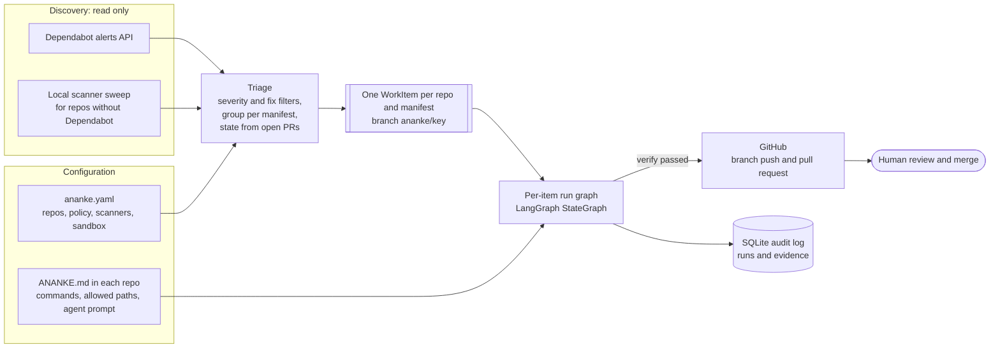
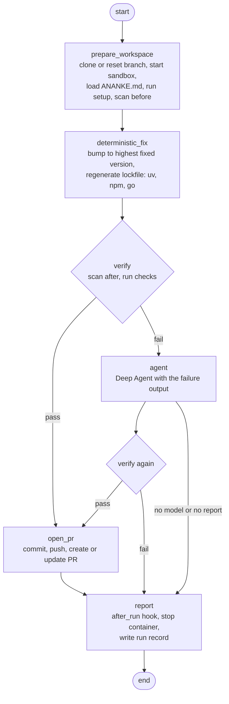
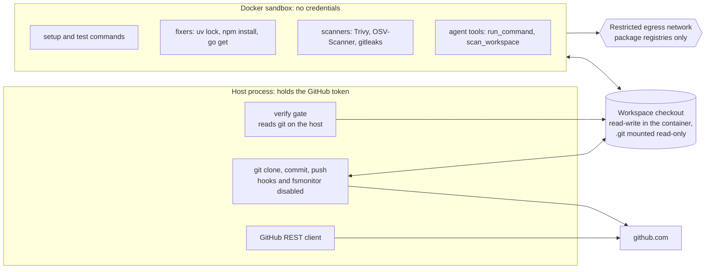

# Ananke

> Ἀνάγκη: necessity. Security patches are not optional work; Ananke makes them inevitable.

Ananke is a long-running agent that watches GitHub repositories for security findings that
already have a known fix, and turns each group of findings into a reviewed, mergeable pull request
that carries its own proof of work. It is built with Python, LangChain, LangGraph and Deep Agents.
[PLAN.md](PLAN.md) is the full specification.

## The name

In Greek myth, **Ananke** is the primordial goddess of necessity, compulsion and inevitability.
Orphic cosmogony places her at the very beginning of the world, coiled around the cosmic egg with
Chronos, Time, and setting the heavens turning. In Plato's *Republic*, the Myth of Er describes
the Spindle of Necessity turning on her knees while her daughters, the three Fates, sing of what
was, what is and what will be. The Greeks held that not even the gods fight against necessity.
The Romans called her Necessitas.

A known vulnerability with a published fix is exactly that kind of force: the patch has to land
sooner or later. Ananke's job is to make it sooner.

## The idea

Most teams already receive security alerts. What they lack is the time to turn each alert into
a safe, tested change. Dependabot opens a version-bump PR and stops there: if the tests break,
if the fix needs a parent package bumped, or if a major version changes an API, a person has to
take over.

Ananke borrows the shape of OpenAI's [Symphony](https://github.com/openai/symphony), which polls
an issue tracker and runs one isolated coding agent per ticket, and points it at vulnerability
feeds instead:

| Dependabot does | Ananke does |
|---|---|
| Opens a bump PR and gives up if tests fail | Bumps, runs the tests, fixes the code that broke, and only then opens the PR |
| One PR per dependency | One PR per manifest, consolidating every open alert |
| Cannot fix transitive deps that need a parent bump | Regenerates the lockfile and lets the agent reason about the dependency graph |
| Only ecosystems GitHub supports, only when enabled | Runs pluggable local scanners (Trivy, OSV-Scanner, gitleaks), so it also covers repos without Dependabot |
| No proof of work | Every PR carries a before/after report from every enabled scanner, with tool and database versions, plus test output |

Four principles shape the design:

1. **Cost ladder.** Every item is first tried deterministically, with no model at all: bump the
   pin, regenerate the lockfile, run the tests. The agent runs only when that fails, and it starts
   from the failure output. Token spend stays proportional to difficulty.
2. **Proof, not promises.** A deterministic verify gate decides whether a PR may open. It
   re-runs every scanner, checks the diff, runs the tests and looks for disabled tests. The agent
   cannot talk its way past it.
3. **Credentials never reach the agent.** Untrusted repository code runs in a locked-down Docker
   container. Cloning, pushing and PR creation happen on the host, only after verification.
4. **GitHub is the source of truth.** Open alerts and open PRs say what still needs doing. Local
   SQLite is an audit log, never a work queue. A human reviews and merges every PR.

## Architecture

### System overview



### The per-item run graph

Every work item runs through the same graph. Only the `agent` node can involve a model; every
other node is plain code.



With `--dry-run`, `open_pr` commits locally and renders the PR body but pushes nothing. In M1 the
agent node runs only with a scripted fake model; the live model arrives in M2.

### Trust boundaries



The container runs as the host user's uid with every Linux capability dropped, a process limit,
CPU and memory limits, and no Docker socket. The agent has no push tool, and a push from inside
the container is impossible because no token exists there. See [docs/TRUST.md](docs/TRUST.md).

### The verify gate

All checks are code; a failed check blocks the PR.

| Check | What it enforces |
|---|---|
| `diff_nonempty` | Something actually changed |
| `paths_allowed` | Only allowed paths changed; CI workflows, keys and secrets files are protected |
| `diff_size` | The change stays under `max_diff_lines`; lockfile churn is exempt |
| `targets_resolved` | Every targeted advisory is gone from every scanner that covers its ecosystem |
| `no_regressions` | No scanner reports a new finding at or above the regression severity |
| `no_secrets` | No new secret findings |
| `tests` | The repo's test command passes, unless `ANANKE.md` marks tests advisory |
| `lockfile_consistent` | The lockfile matches the manifest: `uv lock --check`, `npm ci --dry-run`, `go mod verify` |
| `no_test_tampering` | No skipped, removed or deleted tests unless the agent explains each one |
| `scanner_db_fresh` | Warns in the PR body when a vulnerability database is stale |

## Status

| Milestone | Scope | Status |
|---|---|---|
| M0 | Scaffold, config, Dependabot source, GitHub client, scanner parsers, workflow rendering, triage, `scan` / `scanners` / `validate` | done |
| M1 | One run end to end: Docker sandbox, deterministic fixers, verify gate, PR rendering and creation, audit store, fake-model agent path | done and unit-tested offline; the Docker integration test has not run yet |
| M2 | Live agent rung with Claude | gated: needs an explicit go-ahead |
| M3 | Daemon: polling, claims, retries, reconciliation, restart recovery | planned |
| M4 | Operations: Slack, status API, budgets, auto-merge policy | planned |
| M5 | Reach: CodeQL alerts, container images, more scanners, rework runs | planned |

No milestone so far makes a live model call. The only place a chat model can be constructed is
`src/ananke/llm.py`, behind a three-way gate: config, environment variable and CLI flag.

## Quick start

```bash
uv sync
cp ananke.yaml.example ananke.yaml
# Set repos and GitHub credentials in ananke.yaml or the environment variables it references.
uv run ananke validate --config ananke.yaml
uv run ananke scan --fixtures tests/fixtures --config ananke.yaml.example --all
uv run ananke scanners --config ananke.yaml.example
```

Read-only commands:

```text
ananke validate --config PATH
ananke scan --config PATH [--fixtures DIR] [--json] [--all]
ananke scanners --config PATH
```

`scan` fetches open Dependabot alerts and existing Ananke PRs for the configured repositories and
needs GitHub credentials. With `--fixtures DIR` it reads `DIR/dependabot_alerts/open.json` for
every configured repo and makes no network calls. `--all` also lists findings dropped by policy,
and `--json` emits machine-readable output. `scanners` lists registered scanner plugins and
whether their binaries are present on this host.

One-item run:

```text
ananke run ITEM_KEY --config PATH --dry-run
ananke run ITEM_KEY --config PATH --dry-run --fake-model tests/fixtures/fake_model_scripts/simple_bump.json
ananke run ITEM_KEY --config PATH --yes
ananke run ITEM_KEY --config PATH --dry-run --fixtures DIR --clone-url PATH_OR_URL [--default-branch main]
```

`ITEM_KEY` is the key or branch suffix shown by `scan --json`. `run` executes the graph above.
`--dry-run` prints the PR body and pushes nothing; `--yes` pushes the branch and opens or updates
the PR. If verify fails, the agent rung runs only with `--fake-model SCRIPT`. The exit code is 0
only for the `dry_run` and `pr_opened` outcomes; failed checks are printed to stderr. With
`--fixtures DIR --clone-url PATH_OR_URL`, `run` needs no GitHub access at all.

Every run is recorded with its evidence in `<workspace.root>/.ananke/runs.sqlite3`.

Docker is required unless `sandbox.allow_local: true` is set. Local mode executes untrusted
commands directly on the host and exists only for development and tests.

## Repository layout

```text
src/ananke/
  cli.py            validate | scan | scanners | run   (daemon, status: M3)
  config.py         ananke.yaml and ANANKE.md front matter models
  workflow.py       strict Jinja2 rendering of prompts, PR bodies and failure issues
  llm.py            the only place a chat model is built; live-model gate
  sources/          Dependabot alerts, local scanner sweep
  scanners/         Trivy, OSV-Scanner, gitleaks plugins and the normalized delta
  orchestrator/     triage, scan command, SQLite audit store
  github/           App/PAT auth, REST client, PR and issue writes
  worker/           run graph, sandbox, workspace, fixers, verify gate, agent and tools
docker/             worker image with the scanners and their databases baked in
templates/          default ANANKE.md, PR body, failure issue
docs/               TRUST.md, SCANNERS.md, ARCHITECTURE.md
tests/              unit (offline), integration (Docker), live (never by default), fixtures
```

## Configuration and docs

- [`ananke.yaml.example`](ananke.yaml.example): repositories, scanners, policy, GitHub
  authentication and sandbox settings. Secrets are referenced as `$VAR`.
- [`templates/ANANKE.default.md`](templates/ANANKE.default.md): the default per-repo workflow; a
  target repository may ship its own `ANANKE.md`.
- [`docs/TRUST.md`](docs/TRUST.md): credentials, sandbox, network and approval boundaries.
- [`docs/SCANNERS.md`](docs/SCANNERS.md): the scanner plugin contract and how to add a scanner.
- [`docs/ARCHITECTURE.md`](docs/ARCHITECTURE.md): component boundaries and the run flow.

## Development

```bash
uv run pytest                                 # offline unit tests, under 60 s
uv run ruff check . && uv run ruff format --check .
```

Tests that need Docker, scanner binaries or live services are marked `docker`, `binaries` and
`live` and are excluded by default. The unit tests drive the whole run graph with a fake scanner,
a local bare git remote in place of GitHub, and the scripted fake model.

The M1 integration test runs the graph in the real worker container with the real scanners:

```bash
docker build -f docker/worker.Dockerfile -t ghcr.io/renci/ananke-worker:latest .
uv run pytest -m docker
```

### Regenerating scanner fixtures

The scanner fixtures were hand-written from each tool's documented JSON schema because the dev
host has no scanner binaries. On a host with `trivy`, `osv-scanner`, `gitleaks`, `uv` and `npm`:

```bash
scripts/regen_scanner_fixtures.sh
PY_REQUESTS_FIX=2.32.4 PY_URLLIB3_FIX=2.5.0 scripts/regen_scanner_fixtures.sh
```

The script copies the fixture repos to a temp directory, runs before and after scans, and replaces
the fixtures only when every scan succeeds.
